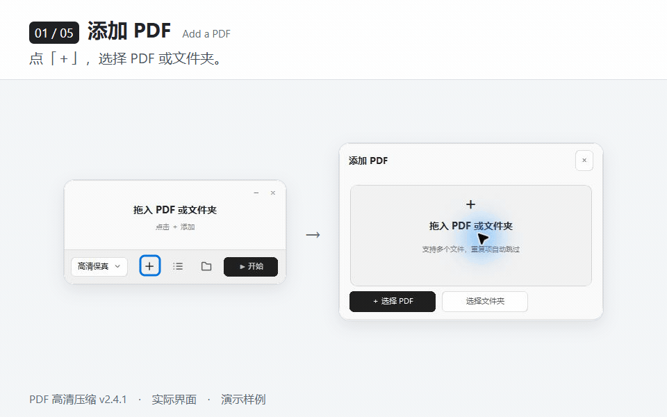
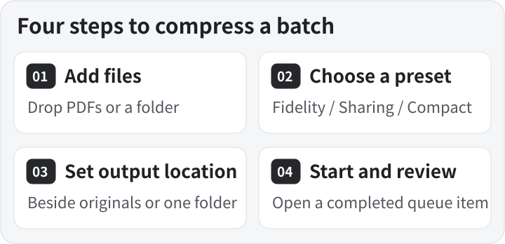
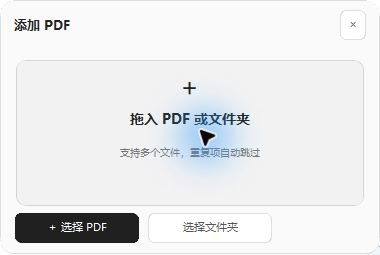
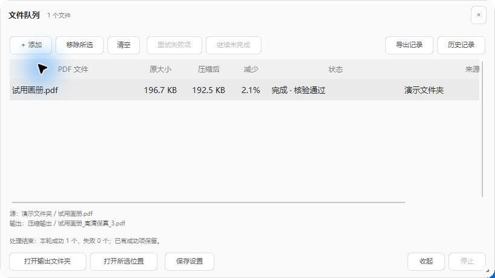
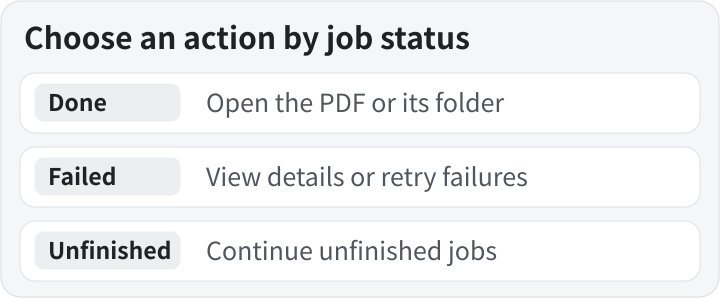
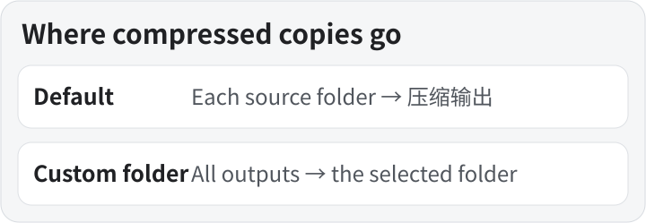

# PDF Compressor

[简体中文](README.md) · [Install](#install) · [Quick start](#quick-start) · [Presets](#presets) · [File queue](#file-queue) · [Output location](#output-location) · [FAQ](#faq)

Compress batches of PDFs offline on Windows. Drop in brochures, product documents, or scans, pick a preset and output location, and save compressed copies alongside the originals or to a folder of your choice.

*A v2.4.1 demo assembled from actual interface captures. The compression wait is skipped.*

## Install

**[Download the v2.4.1 installer](https://github.com/xmonk888-art/pdf-compressor/releases/download/v2.4.1/PDFCompressor-2.4.1-Setup.exe)** · [Release notes and checksums](https://github.com/xmonk888-art/pdf-compressor/releases/tag/v2.4.1)

The installer targets Windows 10/11 x64 and includes its runtime. Installation and compression work offline without a separate Python installation. The public installer is unsigned. Its SHA-256 is listed on the release page.

- **First installation.** Run the installer, choose a folder, and open the desktop shortcut labeled **PDF高清压缩**.
- **In-place upgrade.** Use the same Windows account. Finish or stop active jobs, exit the old version, and run the new installer. The wizard keeps the existing installation folder.
- **Change the installation folder.** Uninstall the old version first, then choose a new folder. Uninstalling preserves PDFs, preferences, and history.

## Quick start

1. Drop one or more PDFs or a folder onto the main window. You can also select **＋** to browse. Folder input adds PDFs directly inside that folder. The queue skips files already added.
2. Select a preset. Try one representative file and check fine text and images in the result.
3. Select the folder icon to choose an output location. By default, each output goes into a **压缩输出** folder beside its source.
4. Select **Start** (开始). The main window displays progress. Double-click a completed row in the queue to open its compressed PDF.

The toolbar icons open Add, File Queue, and Save Settings panels. Panels dock beside the main window. Click the same control again to hide its panel. `Ctrl+O` opens Add, and `Ctrl+L` toggles the queue.

*The Add panel accepts dropped files and lets you browse for PDFs or a folder. Select a screenshot to open it at full size.*

## Presets

| Preset | Suitable for | When to use it |
| --- | --- | --- |
| **High fidelity (高清保真)** | Brochures, product documents, and regular printing | Start here when image detail matters. This is the default each time the app starts. |
| **Everyday sharing (日常分享)** | Email attachments and online circulation | Balances legibility and size. |
| **Compact preview (小巧预览)** | Phone previews and transfers | Resizes eligible images more aggressively. Check fine text and detailed images after processing. |

The engine optimizes eligible embedded images and checks page count, dimensions, text, vector content, and rendering differences. Images with protected color spaces or special masks are skipped where needed. If compression yields no smaller result, the app writes a copy with the same content as the original.

## File queue

*Actual output from the demo PDF, with sample paths shown. Select a completed item and choose Open selected location to find its compressed copy.*

Each row shows the source size, output size, reduction, status, and source folder. Select a row to see its full path. Use the context menu to open source or output folders, or copy paths.

| Task | Control |
| --- | --- |
| Open a compressed PDF | Double-click a completed row. |
| Find the output of a specific job | Select a completed row and choose **Open selected location** (打开所选位置). |
| Inspect a failed job | Double-click its row or choose **View processing details** (查看处理详情). |
| Retry failures only | Choose **Retry failed items** (重试失败项). |
| Resume unfinished work | Choose **Continue unfinished** (继续未完成) for pending, stopped, or interrupted jobs in the current queue. Completed jobs are skipped. |
| Remove jobs from the list | Use **Remove selected** (移除所选) or **Clear** (清空). Source PDFs and completed outputs are retained. |

### Stop and processing records

- **Stop a batch.** The Start button becomes **Stop** (停止) during compression. Completed files remain available.
- **Review or export records.** **History** (历史记录) opens the local CSV folder. **Export records** (导出记录) saves the current session's source and output paths, preset, status, duration, and failure details.

## Output location

- **Default.** Each compressed copy goes to a **压缩输出** folder beside its source. PDFs from different folders are saved separately.
- **Custom folder.** Select the folder icon and choose a directory. The batch goes there, and the app remembers the setting for the next launch.
- **Existing filenames.** The app adds a number to keep existing files intact.

## FAQ

**Why is the result the same size?** An already optimized PDF, or one made mostly of text and vector graphics, may have little room for further image compression. The app then writes a copy with the original content.

**What about encrypted or signed PDFs?** If you have permission, save an unencrypted or unsigned copy in a PDF application before adding that copy to the queue.

**Are files uploaded?** Compression runs locally. Preferences and CSV history are stored under the current user's `%LOCALAPPDATA%\PDFCompressor` folder.

## Source and license

The application is released under GNU AGPL v3. The release includes the application source, build scripts, and the corresponding PyMuPDF and MuPDF sources.

[Download source](https://github.com/xmonk888-art/pdf-compressor/releases/download/v2.4.1/PDFCompressor-2.4.1-Source.zip) · [Build instructions](https://github.com/xmonk888-art/pdf-compressor/blob/v2.4.1/BUILD.md) · [License](https://github.com/xmonk888-art/pdf-compressor/blob/v2.4.1/LICENSE) · [Third-party notices](https://github.com/xmonk888-art/pdf-compressor/blob/v2.4.1/THIRD_PARTY_NOTICES.md)
