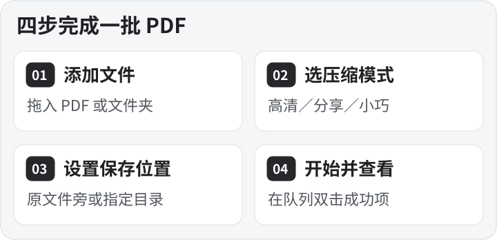

# PDF 高清压缩

[English](README.en.md) · [下载安装](#下载安装) · [一分钟上手](#一分钟上手) · [压缩模式](#压缩模式) · [文件队列](#文件队列) · [保存位置](#保存位置) · [常见问题](#常见问题)

在 Windows 上离线批量压缩 PDF。把展册、产品资料或扫描件拖进窗口，选好清晰度和保存位置，就能批量生成压缩副本。原 PDF 保留在原处。

*v2.4.1 试用演示。动图由实际界面截图串联，压缩等待段已略过。*

## 下载安装

**[下载 v2.4.1 一键安装包](https://github.com/xmonk888-art/pdf-compressor/releases/download/v2.4.1/PDFCompressor-2.4.1-Setup.exe)** · [查看发行说明和校验值](https://github.com/xmonk888-art/pdf-compressor/releases/tag/v2.4.1)

安装包适用于 Windows 10/11 x64，自带运行环境。安装和压缩都可以离线完成，无需另装 Python。公开安装包未做数字签名，可在发行页核对 SHA-256。

- **首次安装**。运行安装包，选择安装目录，再从桌面「PDF高清压缩」快捷方式启动。
- **原位升级**。使用同一个 Windows 账户，完成或停止任务，退出旧版，再运行新版安装包。向导会沿用原安装位置。
- **更换安装目录**。先卸载旧版，再运行安装包并选择新位置。卸载保留 PDF、本地设置和历史记录。

## 一分钟上手

1. **添加文件**。把一个或多个 PDF、或包含 PDF 的文件夹拖入主窗。也可点「＋」选择文件或文件夹。选择文件夹时，程序读取该目录当前层的 PDF。队列会跳过已添加的同一文件。
2. **选压缩模式**。从「高清保真」「日常分享」「小巧预览」选一档。先压一份代表文件，打开结果检查细小文字和图片。
3. **选保存位置**。点击文件夹图标。默认在每个原文件旁建立「压缩输出」文件夹，也可把本批文件集中保存到指定目录。
4. **开始并查看结果**。点击「开始」，主窗会显示压缩进度。完成后打开文件队列，双击成功项查看压缩后的 PDF。

工具栏上的「＋」、列表和文件夹图标分别打开添加、文件队列和保存设置。面板会跟随主窗排列，再点原按钮可收起。也可用 `Ctrl+O` 打开添加，`Ctrl+L` 开关文件队列。

*「＋」打开添加面板。可直接拖入文件，也可点底部按钮选择。点击功能截图可查看原图。*

## 压缩模式

| 模式 | 适合场景 | 怎么选 |
| --- | --- | --- |
| **高清保真** | 展册、产品资料、常规打印 | 优先保留图片细节，适合作为第一轮试压。每次启动默认这一档。 |
| **日常分享** | 邮件附件、在线传阅 | 在可读性与文件体积之间取平衡。 |
| **小巧预览** | 手机上快速预览、传输较大的 PDF | 允许更积极地缩小图片，选这档后可重点查看小字和精细图片。 |

压缩主要优化符合条件的嵌入图片。引擎会核对页数、页面尺寸、文字、矢量内容和渲染差异。含有需要保护的色彩空间或特殊遮罩的图像会跳过相应处理。如果处理结果没有变小，程序会保存一份与原文件内容相同的副本。

## 文件队列

*这是试用画册的实际结果，来源和输出路径以演示名称显示。选中成功项后，可用底部「打开所选位置」找到压缩件。*

队列逐项显示原大小、压缩后大小、减少比例、任务状态和来源文件夹。选中一行可查看完整路径，右键可打开来源文件夹或输出位置，也可复制路径。

| 想做什么 | 在哪里操作 |
| --- | --- |
| 查看压缩件 | 双击成功项。 |
| 找到这一个文件的压缩件 | 选中成功项，点「打开所选位置」。从多个源目录压缩时，可逐个打开各自的输出目录。 |
| 查失败原因 | 双击失败项查看状态和详情，或右键选「查看处理详情」。 |
| 只重跑失败项 | 点击「重试失败项」，处理失败或启动失败的任务。 |
| 接着跑未完成的项 | 点击「继续未完成」，处理当前队列中待处理、已停止或异常中断的任务。已经成功的任务会跳过。 |
| 移出队列 | 「移除所选」处理选中项，「清空」处理整张队列。原 PDF 和已生成的压缩件都会保留。 |

### 停止与处理记录

- **停止当前批次**。压缩时主按钮会切换为「停止」。已经完成的文件会保留，回到队列后可用「继续未完成」处理剩余文件。
- **找上次的处理结果**。队列中的「历史记录」打开本地 CSV 文件夹。「导出记录」可另存当前会话的处理记录，包含源文件、输出文件、模式、状态、耗时和失败原因。

## 保存位置

- **默认保存**。每个 PDF 的压缩副本放在它自己原目录旁的「压缩输出」文件夹。源文件来自不同目录时，输出也会分别保存。
- **指定文件夹**。点文件夹图标，选择「指定文件夹」。当前批次集中输出到这个目录，下次打开软件会沿用这个设置。
- **遇到重名**。输出自动使用带序号的文件名，保留已存在的文件。

## 常见问题

**为什么有的 PDF 压缩后大小没变？** 文件可能已经压缩得很充分，或以文字和矢量图为主，可进一步优化的图片较少。程序会保留与原文件内容相同的副本。

**文件是加密的，或者带数字签名，怎么处理？** 请在有权限的情况下，用 PDF 软件另存为未加密或未签名的副本，再把副本添加到队列。

**文件会上传吗？** 压缩在电脑本地进行。设置与 CSV 历史保存在当前用户的 `%LOCALAPPDATA%\PDFCompressor` 下。

## 源码与许可

应用按 GNU AGPL v3 发行。发行页提供应用源码、构建脚本以及对应的 PyMuPDF 和 MuPDF 源码。

[下载应用源码](https://github.com/xmonk888-art/pdf-compressor/releases/download/v2.4.1/PDFCompressor-2.4.1-Source.zip) · [构建说明](https://github.com/xmonk888-art/pdf-compressor/blob/v2.4.1/BUILD.md) · [许可证](https://github.com/xmonk888-art/pdf-compressor/blob/v2.4.1/LICENSE) · [第三方声明](https://github.com/xmonk888-art/pdf-compressor/blob/v2.4.1/THIRD_PARTY_NOTICES.md)
